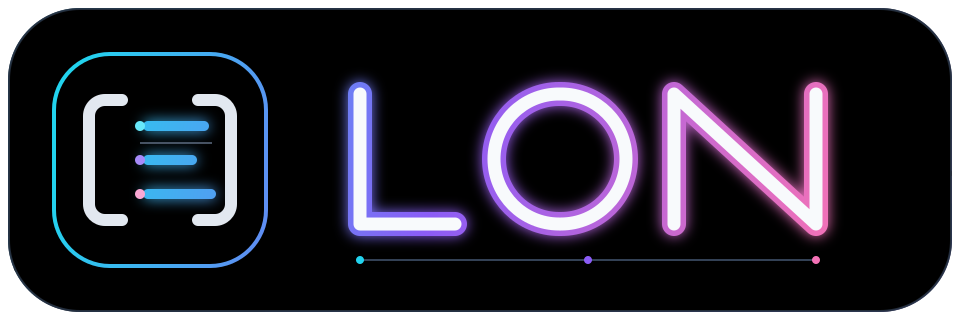

<h1 align="center">LON</h1>

<p align="center">
  <a href="spec/lon-v1.md">
    
  </a>
</p>

<p align="center">
  <a href="spec/lon-v1.md"></a>
  <a href="spec/lon-v1.md"></a>
  <a href="benchmark/results/token-efficiency.md"></a>
  <a href="https://github.com/fluttercandies/lon"></a>
</p>

<p align="center">
  <a href="README.md">English</a> · <strong>简体中文</strong>
</p>

Language Object Notation（LON，语言对象表示法）是面向 JSON 数据模型的紧凑、规范化、无损文本编码。它以 AI-first 数据交换为目标，同时不让人类或模型猜测类型、边界、schema 或被省略的结构。

> 格式版本：`LON v1`

本仓库是多语言 monorepo：规范文档、一致性 fixtures、benchmark 和品牌资产与语言无关，每种实现位于自己的目录中。

## 为什么选择 LON

- **JSON 文本无损转换。** 保留对象成员顺序、重复成员、字符串代码单元和数字原始词法。
- **AI-first，但不只服务 AI。** 删除冗余语法，同时保留熟悉的 JSON 定界符和明确的类型边界。
- **自描述表格。** 重复记录键可提取为可见 schema，后续各行使用分号分隔。
- **唯一规范输出。** 解码器接受的不同等价写法会规范化为同一个确定性输出。
- **没有隐藏上下文。** 不使用别名、键字典、数字引用、外部 schema 或模型指令。
- **资源有界。** 在不安全分配或乘法发生前限制解析、展开、嵌套、输入和输出。

## 快速示例

JSON：

```json
{"users":[{"id":1,"name":"Ada"},{"id":2,"name":"Bob"},{"id":3,"name":"Lin"}]}
```

规范 LON：

```lon
{users:[id name;1 Ada;2 Bob;3 Lin]}
```

载荷本身仍然自描述：

- `[` 和 `]` 仍是解码后数组的边界。
- `id name` 是可见记录 schema；第一个 `;` 结束 schema。
- 后续每个 `;` 开始新行，行宽必须与 schema 完全一致。
- 空格分隔字段，不再增加行圆括号或另一种分隔符。

对于小型或非统一数据，LON 保持接近 JSON：

```json
{"id":7,"name":"Ada","active":true}
```

```lon
{id:7 name:Ada active:true}
```

完整语法和规范表格选择规则见 [LON v1 规范](spec/lon-v1.md)。

## 实现列表

| 语言 | 状态 | 入口 |
|---|---|---|
| Dart | 已就绪 | [`dart/`](dart/README.zh-CN.md) · [pub.dev 上的 lon](https://pub.dev/packages/lon) |
| Rust | 已就绪 | [`rust/`](rust/README.md) · [crates.io 上的 lon](https://crates.io/crates/lon) |

每种实现都基于共享的[一致性 fixtures](conformance/v1.json) 验证。

## 仓库结构

| 路径 | 用途 |
|---|---|
| `spec/lon-v1.md` | 规范格式文档 |
| `conformance/v1.json` | 跨实现一致性 fixtures（[schema](conformance/schema.json)） |
| `benchmark/` | 可复现多格式 token benchmark |
| `editors/` | 编辑器支持（VS Code 语法高亮与语言配置） |
| `assets/` | 可缩放 LON 横向 Logo 与独立标识 |
| `dart/` | Dart 实现、CLI 与测试 |
| `rust/` | Rust 实现、CLI 与测试 |

## Token benchmark

可复现 benchmark 在 27 个确定性小型、中型和大型场景中比较 LON、Compact JSON、TOON、YAML 和 Pretty JSON。每份载荷都必须先解码还原为原始 JSON 值，之后才会计数，并以 LON 作为对比基准。

阅读[人类可读 benchmark 报告](benchmark/results/token-efficiency.md)或[机器可读结果](benchmark/results/token-efficiency.json)。复现方式：

```sh
cd benchmark
bun install --frozen-lockfile
bun run benchmark
```

## 设计边界

LON 编码 JSON 数据模型。它不添加注释、时间戳、二进制 blob、引用、任意对象类型或推断式应用 schema。保持这条边界，才能强制保证规范 round-trip 以及 AI 和人类无歧义理解。

## 许可证

LON 使用 [BSD 3-Clause License](LICENSE)。
